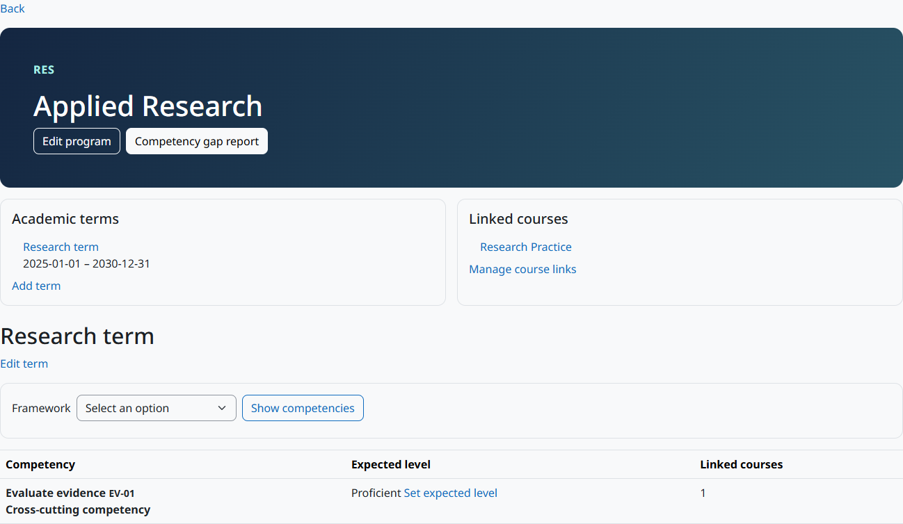

# SkillUps Competency Manager

**SkillUps Academy Moodle Innovation Suite** · `local_skillupscompetency`

Enlaza los marcos, escalas y competencias de Moodle con programas, períodos y niveles esperados. Incluye autoevaluación, evaluación docente por rúbrica, evidencias privadas, revisión de coordinación e informes de brechas.

## Instalación

Instala el [ZIP de Competency Manager](../releases/skillupscompetency/skillupscompetency-0.9.0-beta.1.zip) desde **Administración del sitio → Plugins → Instalar plugins**. Para desplegar por consola, copia `skillupscompetency` al directorio `local` de la raíz web y ejecuta `php admin/cli/upgrade.php --non-interactive` desde la raíz de Moodle. Habilita el subsistema de competencias en Moodle.

- [Instalación, permisos y actualización](docs/administration.md)
- [Manual del usuario](docs/usage.md)
- [Arquitectura y modelo de datos](docs/architecture.md)
- [Seguridad y privacidad](SECURITY.md)
- [Validación](docs/validation.md)
- [Material de revisión en Moodle Marketplace](docs/marketplace.md)

Licencia GNU GPL v3 o posterior. SkillUps Academy es un proyecto independiente.
