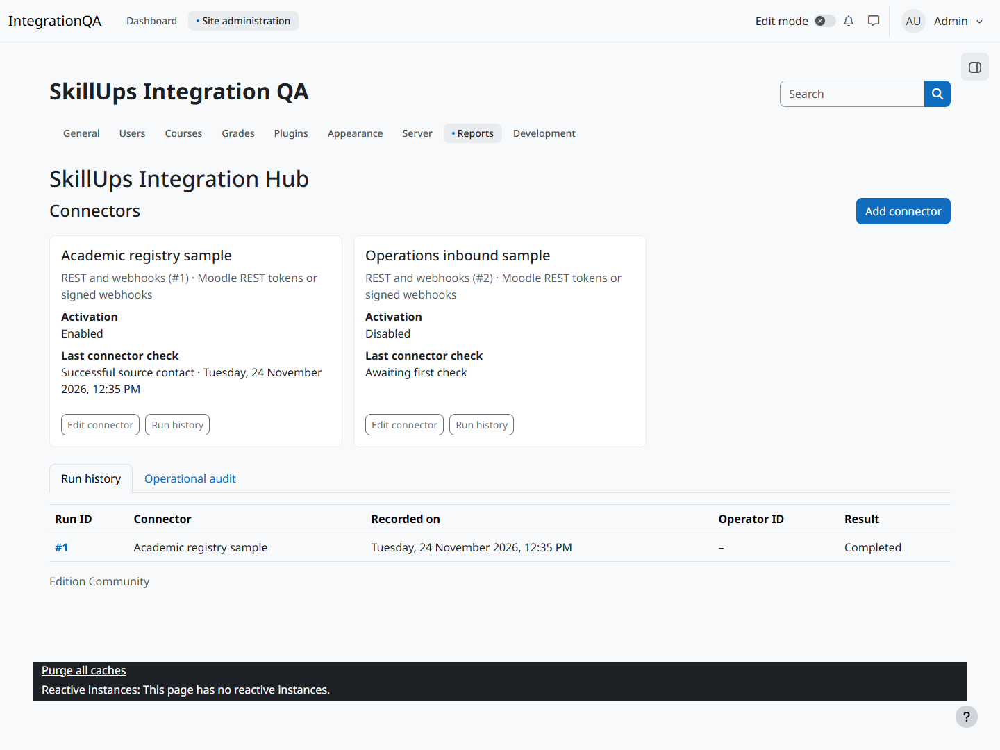

# SkillUps Integration Hub

**SkillUps Academy Moodle Innovation Suite** · `local_skillupsintegration`

SkillUps Integration Hub helps administrators bring user and course records into Moodle from Google Workspace, Microsoft 365, academic systems and human resources systems. It includes connector-specific authentication, field mapping, transformations, authenticated REST and webhooks, simulation, explicit approval, asynchronous execution and run history.

## Instalación

Instala el [ZIP](../releases/skillupsintegration/skillupsintegration-0.9.0-beta.1.zip) en Moodle 5.0 o posterior mediante **Administración del sitio → Plugins → Instalar plugins**. En despliegues por consola, extrae la carpeta `skillupsintegration` en `local` del código web y ejecuta `php admin/cli/upgrade.php --non-interactive` desde la raíz de Moodle. Abre **Administración del sitio → Informes → SkillUps Integration Hub**. El ZIP incluye inglés y español.

| Documento | Contenido |
| --- | --- |
| [Instalación y administración](docs/administration.md) | Capacidades, credenciales, rotación, cron y licencias |
| [Conectores](docs/connectors.md) | Configuración de Google Workspace, Microsoft 365, SIS y RR. HH. |
| [Contrato REST y webhooks](docs/api.md) | Formatos, autenticación, ejemplos y errores |
| [Manual de operación](docs/operations.md) | Simulación, aprobación, conflictos y reintentos |
| [Arquitectura](docs/architecture.md) | Módulos, concurrencia y flujos de datos |
| [Seguridad y privacidad](SECURITY.md) | Límites y tratamiento de datos |
| [Validación](docs/validation.md) | Matriz de Moodle, bases de datos y alcance observado |
| [Moodle Marketplace](docs/marketplace.md) | Materiales para el envío |

Community funciona con Moodle, sin una cuenta comercial. Licencia GPL v3 o posterior. SkillUps Academy es un proyecto independiente.
