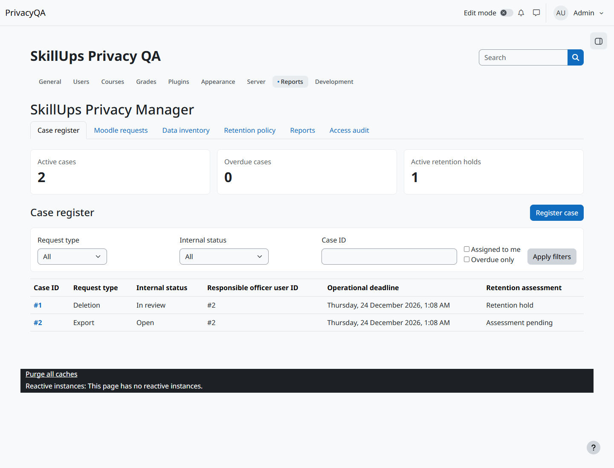

# SkillUps Privacy Manager

**SkillUps Academy Moodle Innovation Suite** · `local_skillupsprivacy`

SkillUps Privacy Manager adds an institutional case register to Moodle's native privacy tools. Privacy officers can track access, export, deletion and anonymization requests, assign owners, record decisions and retention holds, receive deadline reminders and download minimized operational evidence.

The plugin reads native export and deletion requests and the effective purpose in Moodle's data registry. Moodle handles native processing and user data exports. The plugin also declares, exports and erases its own records through the Moodle Privacy API when called by an approved native operation.

## Instalación

Requiere Moodle 5.0 o posterior y `tool_dataprivacy`. Descomprime el [ZIP del plugin](../releases/skillupsprivacy/skillupsprivacy-0.9.0-beta.1.zip) en `local/skillupsprivacy` o utiliza **Administración del sitio → Plugins → Instalar plugins**. En instalaciones con un directorio web `public`, la ruta física es `public/local/skillupsprivacy`. Continúa con la actualización de Moodle y abre **Administración del sitio → Informes → SkillUps Privacy Manager**. El ZIP incluye inglés y español.

| Documento | Contenido |
| --- | --- |
| [Administración](docs/administration.md) | Instalación, capacidades, ajustes y licencias |
| [Guía de operación](docs/operations.md) | Solicitudes, retención, alertas, informes y exportación |
| [Arquitectura](docs/architecture.md) | Esquema, sincronización, flujos de datos y concurrencia |
| [Seguridad](SECURITY.md) | Límites, amenazas y confidencialidad |
| [Validación](docs/validation.md) | Matriz, alcance de las pruebas y limitaciones |
| [Moodle Marketplace](docs/marketplace.md) | Descripción y materiales para revisión |
| [Cambios](CHANGELOG.md) | Historial de versiones |

Community funciona sin una cuenta comercial ni comunicación con SkillUps Cloud. GPL v3 o posterior. SkillUps Academy es un proyecto independiente.
