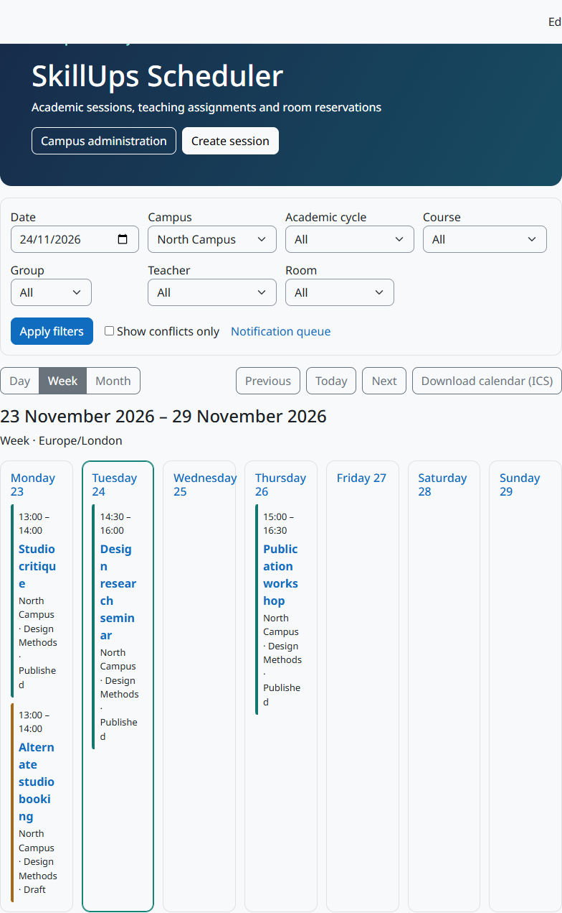

# SkillUps Scheduler

**SkillUps Academy Moodle Innovation Suite** · `local_skillupsscheduler`

Planificador institucional para Moodle que coordina períodos, ciclos, docentes, grupos, aulas físicas y espacios virtuales. Permite preparar borradores, detectar conflictos, publicar sesiones en el calendario nativo y notificar cambios a las personas afectadas.

## Instalación

Instala el [ZIP de Scheduler](../releases/skillupsscheduler/skillupsscheduler-0.9.0-beta.1.zip) desde **Administración del sitio → Plugins → Instalar plugins**. Para una instalación por consola, coloca la carpeta `skillupsscheduler` en el directorio `local` del código web y ejecuta `php admin/cli/upgrade.php --non-interactive` desde la raíz de Moodle.

- [Manual del usuario](docs/usage.md)
- [Instalación, actualización y permisos](docs/administration.md)
- [Arquitectura y modelo de datos](docs/architecture.md)
- [Seguridad y privacidad](SECURITY.md)
- [Validación y compatibilidad](docs/validation.md)
- [Material para revisión en Moodle Marketplace](docs/marketplace.md)

Licencia GNU GPL v3 o posterior. SkillUps Academy es un proyecto independiente.
