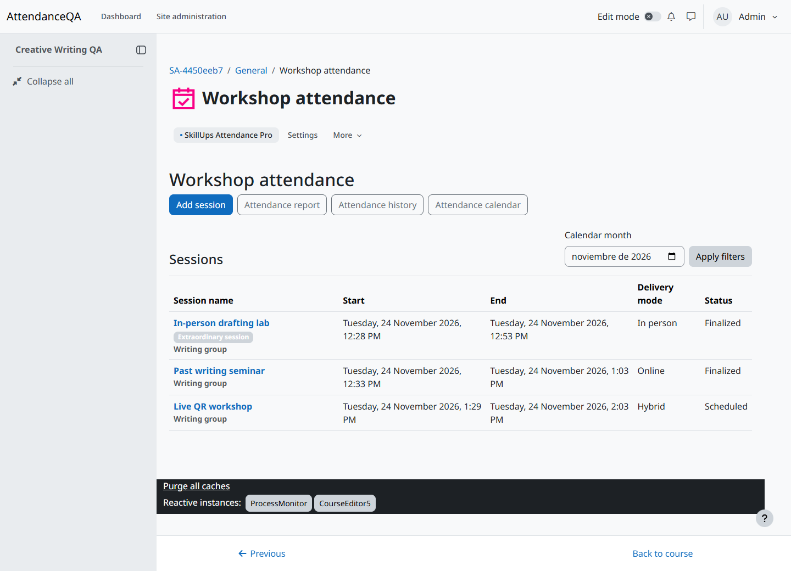

# SkillUps Attendance Pro

**SkillUps Academy Moodle Innovation Suite** · `mod_skillupsattendance`

SkillUps Attendance Pro es una actividad Moodle para planificar sesiones presenciales, virtuales e híbridas. Permite registrar entradas y salidas manualmente o mediante autorregistro, QR temporal y códigos de acceso. Incluye justificaciones con evidencias privadas, informes de asistencia, alertas académicas y publicación explícita en el libro de calificaciones.

## Instalación

Instala el [ZIP de la actividad](../releases/skillupsattendance/skillupsattendance-0.9.0-beta.1.zip) desde **Administración del sitio → Plugins → Instalar plugins**. En un despliegue por consola, coloca `skillupsattendance` en el directorio `mod` del código web y ejecuta `php admin/cli/upgrade.php --non-interactive` desde la raíz de Moodle. Agrega **SkillUps Attendance Pro** desde el selector de actividades de un curso. El ZIP incluye inglés y español.

| Documento | Contenido |
| --- | --- |
| [Administración](docs/administration.md) | Instalación, capacidades, cron, copias y calificaciones |
| [Manual de usuario](docs/usage.md) | Sesiones, registro, justificaciones, reportes y alertas |
| [Arquitectura](docs/architecture.md) | Modelo de datos y APIs de Moodle |
| [Seguridad y privacidad](SECURITY.md) | Autorización, archivos, secretos y conservación |
| [Validación](docs/validation.md) | Compatibilidad y evidencia ejecutada |
| [Moodle Marketplace](docs/marketplace.md) | Material preparado para revisión |

Licencia GNU GPL v3 o posterior. SkillUps Academy es un proyecto independiente.
