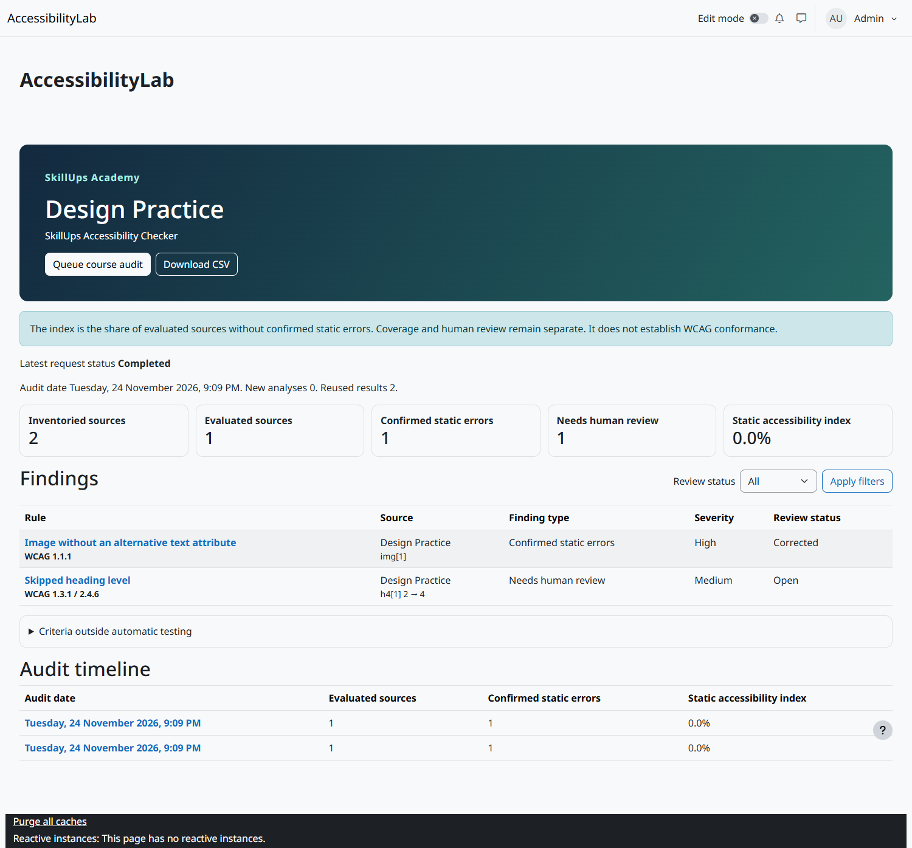

# SkillUps Accessibility Checker

**SkillUps Academy Moodle Innovation Suite** · `report_skillupsaccessibility`

Informe de Moodle para identificar barreras en contenido didáctico, priorizar su revisión y seguir las correcciones. Distingue comprobaciones estáticas, advertencias y fuentes fuera del alcance. Usa WCAG 2.2 como referencia.

## Instalación

Instala el [ZIP](../releases/skillupsaccessibility/skillupsaccessibility-0.9.0-beta.1.zip) desde **Administración del sitio → Plugins → Instalar plugins**. Para instalación manual, coloca `skillupsaccessibility` dentro de `report` en la raíz web de Moodle y ejecuta `php admin/cli/upgrade.php --non-interactive`. Abre el informe desde **Informes** del curso o desde Administración del sitio con el permiso institucional.

- [Manual de usuario](docs/usage.md)
- [Instalación, configuración y permisos](docs/administration.md)
- [Catálogo de reglas WCAG 2.2](docs/rules.md)
- [Arquitectura y modelo de datos](docs/architecture.md)
- [Seguridad y privacidad](SECURITY.md)
- [Pruebas y compatibilidad](docs/validation.md)

Licencia GNU GPL v3 o posterior. SkillUps Academy es un proyecto independiente.
